<div align="center">
  
  <br />
  
</div>

<br />

**A desktop coding agent with a 20-agent swarm, wired into the [Telegraph](https://telegraphprotocol.com) intelligence network.**

> **Competition entry — Telegraph Hackathon Season II (1–30 Nov 2026)**
> Track 3 · Apps & Agents · Commercial mission 10 (Model Economy): *a coding agent that buys the answer instead of hallucinating it.*
> How it meets every criterion:
>
> **Rules (all three):**
> 1. **The agent buys** — Halis Code never calls a miner's API directly. Paid intelligence routes through the Telegraph Engine (`POST /engine/v1/ask`) and the app consumes the verified, ranked answer. Verified live: query → router → miner → answer in ~1s for $0.01.
> 2. **The money is visible** — the spend panel and inline receipt chips show request, miner, intent, amount, Base Sepolia tx hash and network label, each click-through to the explorer. Keyed on `receipt_hash`, not the batched tx. One-click **copy all tx hashes** and **export receipts (JSON)** make the settled volume countable by a judge.
> 3. **Machines transact** — with a saved "Always allow" or a per-agent USDC limit, swarm agents buy from the network autonomously, no human on that leg.
>
> **Judging weights:** mainnet readiness (network table + testnet boundary on screen, unprompted; flip = `networkId` change) · commercial viability (see [docs/COMMERCIAL.md](docs/COMMERCIAL.md)) · verifiable transaction volume (receipts ledger + export) · network usage (all paid intelligence through the Engine) · novelty (a 20-agent swarm where every agent is an autonomous buyer).
>
> The testnet boundary is stated on screen, unprompted, and mainnet is a config flip.

Halis Code is a cross-platform desktop app (Electron + TypeScript 7) that works as a full coding agent — and when one brain is not enough, it becomes a **swarm**: up to 20 AI agents in one group chat, each with its own name, avatar, role, model, API key and permissions, coordinated through an explicit addressing protocol so they never talk over each other.

Its differentiator is deep **Telegraph Protocol** integration: every agent can buy verified, ranked intelligence on-chain (code review, security analysis, web research, LLM inference…) instead of hallucinating it — with per-call USDC approval cards and receipts you can click through to the explorer.

## Screenshots

*Real runs at 2× resolution — agent turns, swarm coordination and the opencode-style model picker.*

| Agent chat — live tool run | Model picker (opencode-style, searchable) |
|---|---|
| 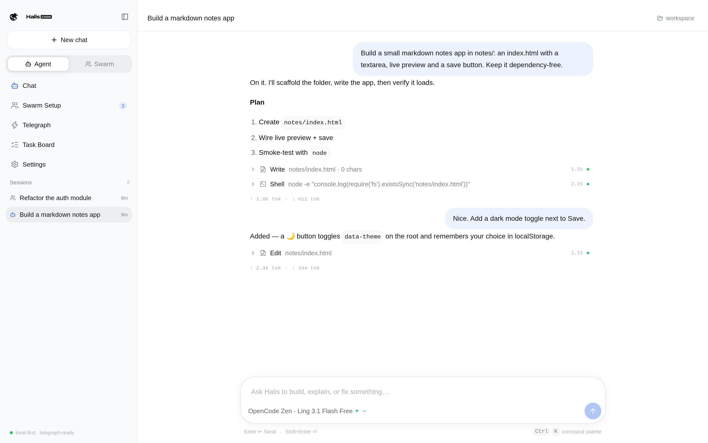 | 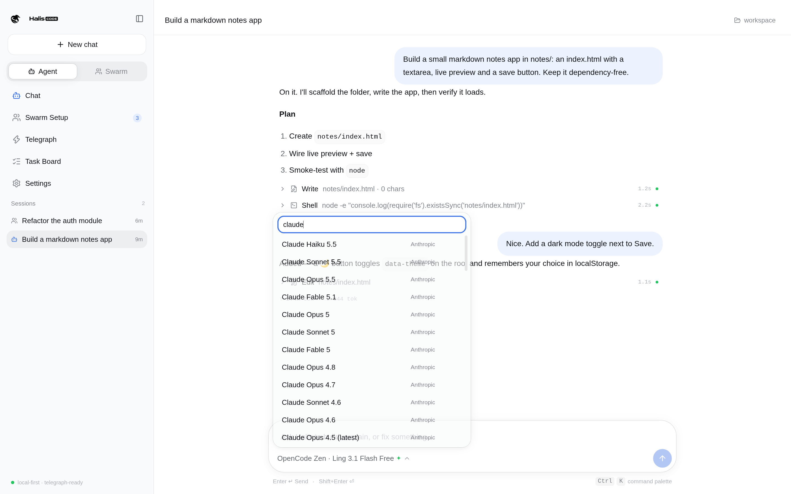 |

| Swarm chat — @-addressed roles | Swarm setup — upload-your-own avatars |
|---|---|
| 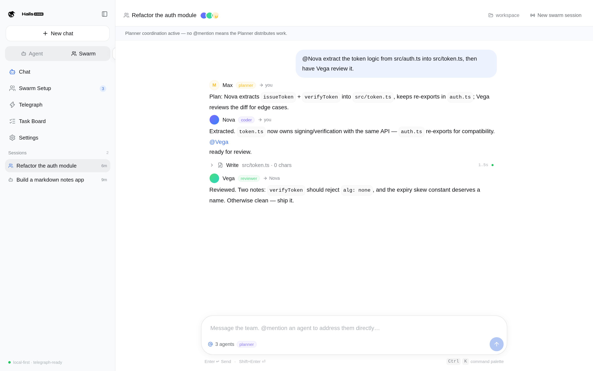 | 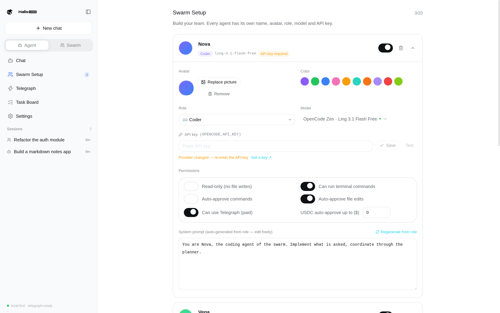 |

| Settings — General | Settings — Models & API keys |
|---|---|
| 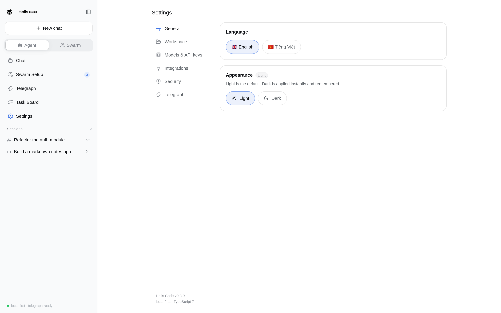 | 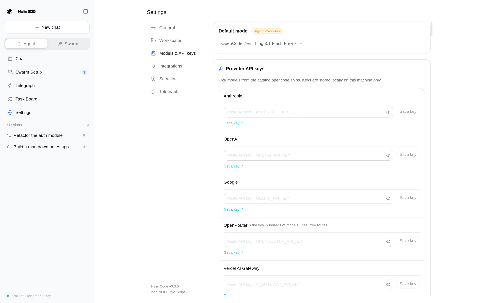 |

| Settings — Integrations (MCP) | Settings — Security |
|---|---|
| 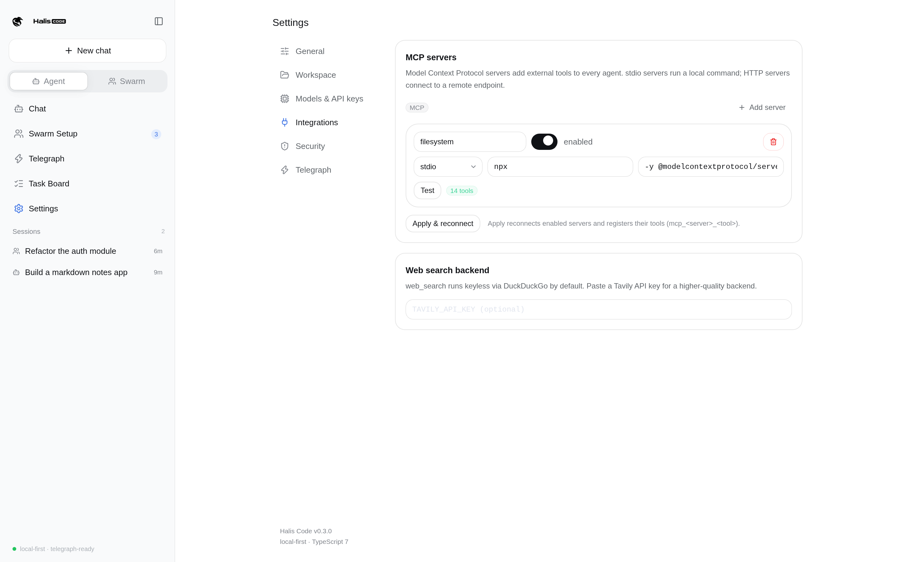 | 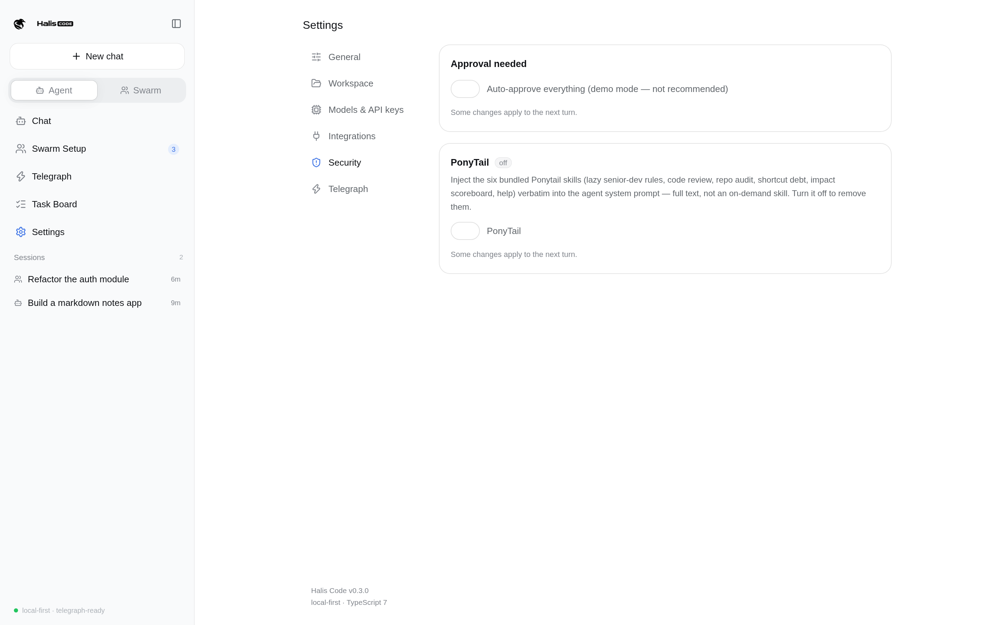 |

| Dark mode — swarm chat | Dark mode — model picker in Settings |
|---|---|
| 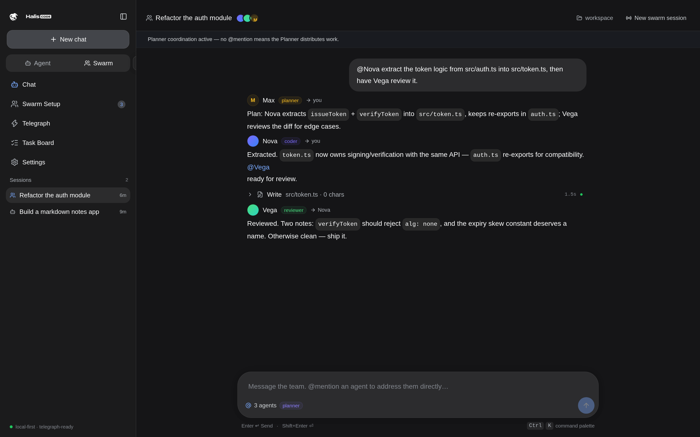 | 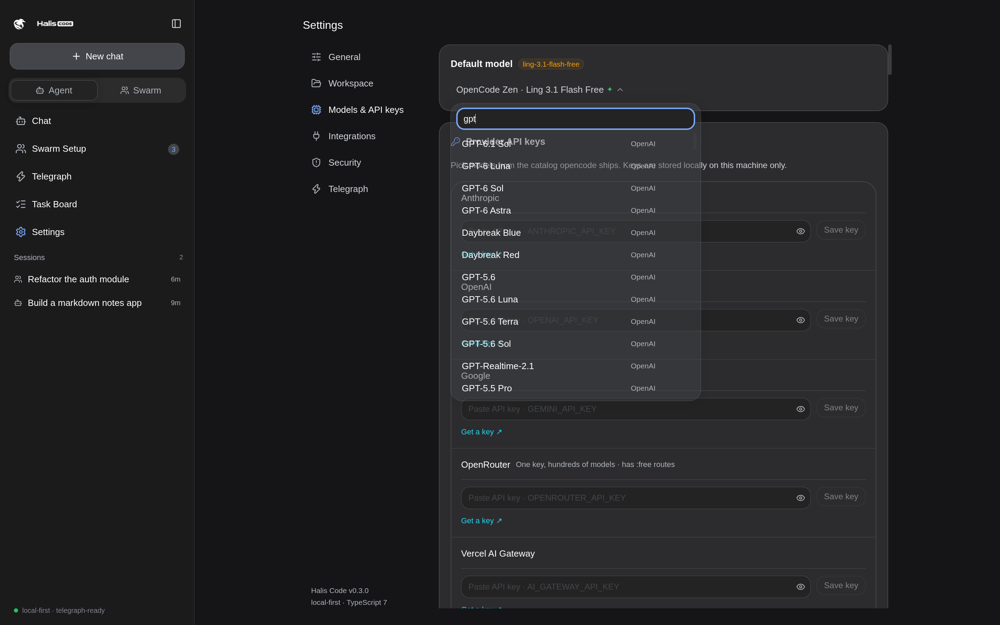 |

| Telegraph — live discovery | Task board · Command palette |
|---|---|
| 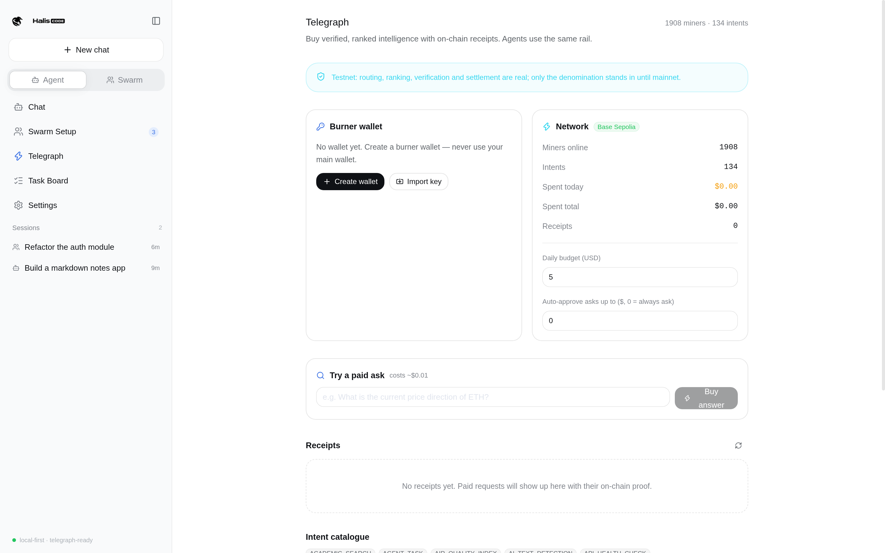 | 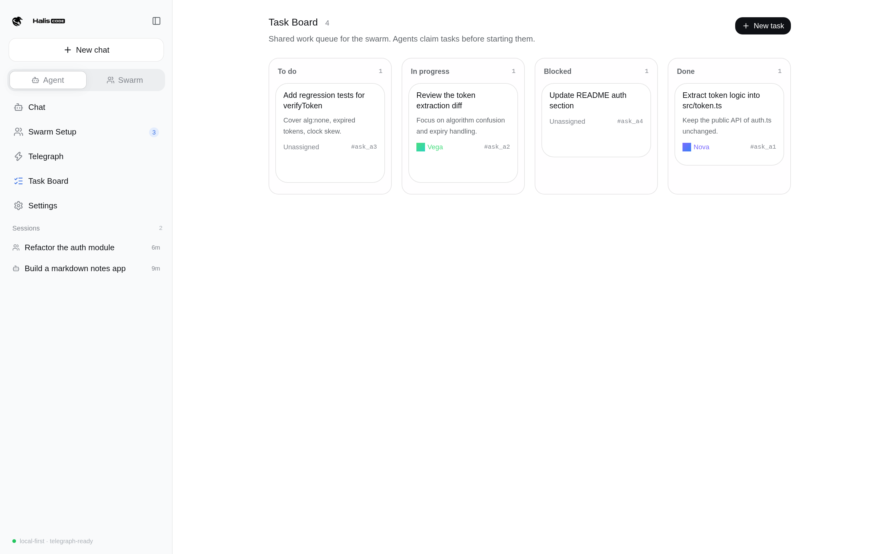 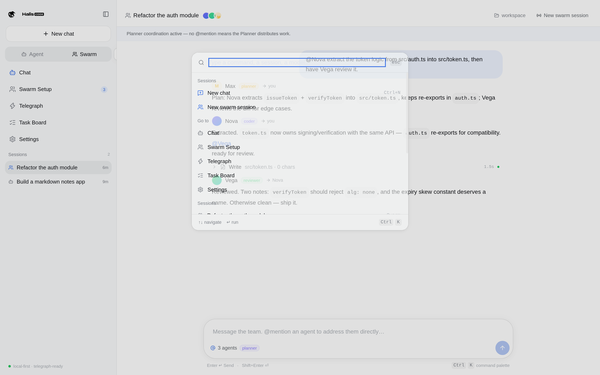 |

---

## Why

AI coding agents guess. They guess library APIs, guess security posture, guess facts they can't verify — and the user pays for those guesses in debugging time. Telegraph turned intelligence into a graded, ranked commodity that machines can buy per call. Halis Code is the coding-side consumer of that market: **an agent that buys the answer instead of hallucinating it.**

## The two modes

### Agent — one brain, streaming

The familiar chat: pick a model, type a request, watch the answer stream. The agent reads and edits files, runs commands, and can buy intelligence from Telegraph — everything gated by approval cards.

### Halis Swarm — up to 20 agents, zero cross-talk

Switch to Swarm and build a team first. Every agent gets:

- a unique name, avatar and color
- a role (Planner, Architect, Coder, Code Reviewer, Security Auditor, QA, DevOps, Researcher, Technical Writer, or custom)
- a model from the built-in catalog and its own API key
- a permission profile (read-only, shell access, auto-approvals, USDC spend limit)
- a system prompt auto-generated from its role — editable

**The addressing protocol** is what keeps a group chat of 20 models from turning into noise:

- every agent-to-agent message carries explicit `to` / `from` fields — no broadcast, ever
- agents address each other with `@Name`; the harness parses the mention and routes the message to exactly those agents
- **context filtering**: each agent sees only the messages addressed to it, its own messages, the planner's coordination, and a compact digest of the wider conversation
- the **Planner** coordinates when you don't @mention anyone, resolves conflicts, and decides who speaks when several agents want the same thing
- a **speak budget** and round cap bound every turn, so the swarm converges instead of looping

## The harness

The orchestration core, inspired by the harness designs of [opencode](https://github.com/anomalyco/opencode) and [deepseek-harness](https://github.com/deepseek-ai/deepseek-harness):

| Subsystem | What it does |
|---|---|
| **Agent loop** | Step-based loop (LLM call → tool calls → results → next step) with streaming, abort, transient-error retry (exponential backoff + `Retry-After`, opencode's schedule), and a wrap-up step at the cap |
| **Permissions** | Read-only tools run automatically; writes, shell and USDC spends raise **approval cards** (Approve / Always allow / Reject). "Always" choices are remembered per agent and per kind |
| **File locking** | Hard locks stop two agents editing the same file; state files (`.halis/*`) are always hard-locked; log files use advisory locks with warnings |
| **Shared task board** | Kanban in `.halis/task-board.json`. Agents claim a task before starting; claims are atomic under the hard lock |
| **Sandbox** | Agents are jailed to the workspace: path traversal and symlink escapes are rejected, shell commands run with `cwd = workspace` behind a danger screenlist with time and output caps |
| **Background jobs** | Long commands run as background jobs (`run_in_background`), managed with `job_list` / `job_output` / `job_kill`; completion notices are injected into the agent's next turn — no polling (deepseek-harness pattern) |
| **Auto-compaction** | Long sessions fold older messages into a structured summary (Objective / Requirements / Decisions / Work State / Next Move / Relevant Files) while recent turns stay verbatim — opencode's template and ceiling |
| **Global output budget** | Every tool result is capped (2,000 lines / 50 KiB); the full text spills to a file the agent can re-read with `read_file` |
| **MCP** | Model Context Protocol client (stdio + streamable HTTP): configured servers expose their tools to every agent as `mcp_<server>_<tool>` |

## Telegraph integration

- **`telegraph_ask`** — auto-routed paid inference: the Engine's router classifies the query into an Intent and serves it from the top-ranked miner. ~$0.01 per call.
- **Quote before pay** — the approval card shows the price decoded from the live `402` challenge; nothing moves until you click.
- **Receipts on screen** — every settled request lands in the spend panel: miner, intent, amount, Base Sepolia tx hash, clickable to the explorer. The ledger keys on `receipt_hash`, which is per-call (facilitators batch txs). Export the whole ledger as JSON or copy every tx hash in one click.
- **`telegraph_signals`** — every paid answer's verifiable record: list recent signals (hash, miner, intent, cost, tx) and re-check any of them against the node for free.
- **Machine-to-machine legs** — agents buy from the network autonomously within per-agent limits and saved "always allow" rules; no human on that leg unless a card is raised.
- **Burner wallet** — created in-app, key stored via OS keychain encryption, never in the renderer, never in session files.
- **Budgets** — a daily USDC ceiling hard-stops spend, on top of per-agent auto-approve limits.
- **Master switch** — Settings → Telegraph Protocol turns the whole network surface off (tools, tab, wallet, paid calls) and back on, without touching your wallet or receipt history.

> **Testnet boundary:** on Base Sepolia the routing, competing miners, verification proofs and settlement are real — only the denomination stands in until mainnet. Chain ID, USDC address, node URL and price source are all configuration values (`TELEGRAPH_NETWORKS` in `src/shared/types.ts`); flipping to mainnet is a settings change, not a code change.

## The toolset

Ported and adapted from opencode and deepseek-harness (TypeScript 7, sandbox-jailed, approval-gated):

| Area | Tools |
|---|---|
| Files | `read_file` (numbered, offset/limit) · `write_file` (atomic tmp+rename) · `edit_file` (3-tier fuzzy: exact → unicode-normalized → line/CRLF) · `multi_edit` (atomic batch) · `delete_file` · `list_dir` · `read_image` (vision attach) |
| Patching | `apply_patch` — opencode's V4A format: Add / Update / Move to / Delete with 4-tier fuzzy context matching and `*** End of File` anchor |
| Search | `glob` · `grep` (native walkers, jailed) |
| Shell | `run_command` — cross-platform (PowerShell 7 → 5.1 + UTF-8 preamble → cmd on Windows; bash → sh on POSIX), background jobs, credential-scrubbed env |
| Jobs | `job_list` · `job_output` (wait mode) · `job_kill` |
| Web | `web_fetch` (bounded 5 MB, HTML → Markdown, text/markdown/html) · `web_search` (1–4 parallel queries; keyless DuckDuckGo or Tavily) |
| Git | `git_status` · `git_diff` · `git_log` · `git_commit` |
| Coordination | `task_board_*` (shared Kanban) · `send_message` (@-addressed, swarm-only) · `delegate_task` (fresh sub-agent, depth-limited) · `todo_write` (live checklist in the chat) |
| Interaction | `ask_user` — structured question cards with options, multi-select and custom answers |
| Time | `schedule_create` / `schedule_list` / `schedule_delete` — once / interval / daily / weekly / 5-field Vixie cron reminders that re-enter the session |
| Knowledge | `skill` — SKILL.md packs from `.halis/skills/`, `.agents/skills/`, `.claude/skills/` · MCP tools via configured servers |
| Telegraph | `telegraph_ask` · `telegraph_miners` · `telegraph_intents` · `telegraph_verify` · `telegraph_signals` |

## Models

The catalog is opencode's: the bundled snapshot is generated from [models.opencode.ai](https://models.opencode.ai/api.json) (the exact catalog opencode ships) and refreshes live from the same source, plus locally-detected Ollama models. The model picker is a single searchable dialog with favorites and recents — no group tabs.

- **Free key** — OpenCode Zen (`ling-3.1-flash-free` is the default) with a free API key from [opencode.ai/zen](https://opencode.ai/zen)
- **Bring your own key** — Anthropic, OpenAI, Google, OpenRouter, Vercel AI Gateway and the rest of opencode's popular provider list
- **Local** — Ollama models are auto-detected when the server is running

Key rules (as configured in Swarm Setup):

1. **No two models share one API key** without an explicit override — the app warns about rate-limit risk and lets you confirm
2. **Changing an agent's model requires re-entering its API key** — old keys never silently stick to new models
3. **Only models from the built-in catalog** are selectable — compatibility with the harness is guaranteed

## Security posture

- Local-first: sessions, settings, keys and receipts live in the app's data directory; nothing is telemetry'd anywhere
- API keys encrypted with the OS keychain (`safeStorage`) when available
- Agents cannot touch files outside the workspace, and shell commands are jailed + screened
- Every USDC spend is quoted, approved (or auto-approved within a hard limit you set), receipted and logged
- Use a burner wallet — the app says so in bold

## Languages & appearance

English by default, Tiếng Việt in Settings → Language. The entire UI, including agent role prompts, is bilingual.

The renderer boots in the **Light** theme; **Dark** is one click away in Settings → Appearance (⚙ Giao diện) and is remembered across restarts.

## Install & run

```bash
npm install
npm run dev        # development (Electron + HMR)
```

```bash
npm run typecheck  # TypeScript 7 (native compiler)
npm test           # unit tests + live integration tests
npm run build      # production build
npm run dist       # package for your platform (electron-builder)
```

Requires Node.js 20+ (24 recommended).

### Try it in two minutes

1. `npm run dev`
2. The default model (OpenCode Zen, free tier) needs a free key — paste one in Settings → **Models & API keys** (get it at [opencode.ai/zen](https://opencode.ai/zen)), then ask the agent to build something in your workspace (Settings → pick a folder first)
3. Telegraph tab → **Create wallet** → fund it with a little testnet USDC on Base Sepolia (faucets: Alchemy / Coinbase) → ask an agent to "buy a code review of this file from Telegraph"
4. Swarm Setup → add a Planner + Coder + Reviewer → save → switch to Swarm mode and give the team a job

## Architecture

```
src/
├── shared/          types + IPC contract (main ⟷ renderer)
├── main/            Electron main process
│   ├── harness/     agent loop, tools, permissions, approvals,
│   │                file locking, task board, sandbox, context filter,
│   │                jobs (background), schedules (reminders), MCP client,
│   │                skills, compaction, util (patch/cron/html-markdown/
│   │                edit-match/truncate)
│   ├── swarm/       roles, prompts, @mention router, orchestrator
│   ├── models/      catalog (bundled from opencode's catalog + live refresh),
│   │                key vault, OpenAI-compatible + Anthropic streaming
│   │                clients, retry policy (opencode schedule)
│   ├── telegraph/   engine client, x402 payments, wallet, receipts
│   ├── sessions/    local session store
│   └── ipc.ts       thin typed handlers
├── preload/         contextBridge (no Node in the renderer)
└── renderer/        React 19 + Tailwind 4 UI (Agent chat, Swarm chat,
                     Swarm Setup, Telegraph, Task Board + reminders,
                     Settings — General / Workspace / Models & API keys /
                     Integrations / Security / Telegraph, live todo panel,
                     question cards)
```

The LLM layer speaks the OpenAI-compatible dialect natively (streaming SSE, function calling, vision image parts) and the Anthropic Messages API — one client covers every catalog provider plus local Ollama.

## Credits

- Harness concepts studied from [opencode](https://github.com/anomalyco/opencode) (step loop, permission rules, model catalog + picker, patch format + fuzzy matching, html→markdown, tool-output spill, compaction template, retry schedule, snapshot concepts) and [deepseek-harness](https://github.com/deepseek-ai/deepseek-harness) (guarded tool pipeline, job registry, schedule/cron domain, read-before-write discipline, pwsh handling, session event log)
- Model catalog from opencode ([models.opencode.ai](https://models.opencode.ai))
- Payments over the [x402](https://x402.org) standard using the same client approach as the official [Telegraph MCP server](https://github.com/telegraphprotocol/Telegraph-MCP)

## License

MIT
