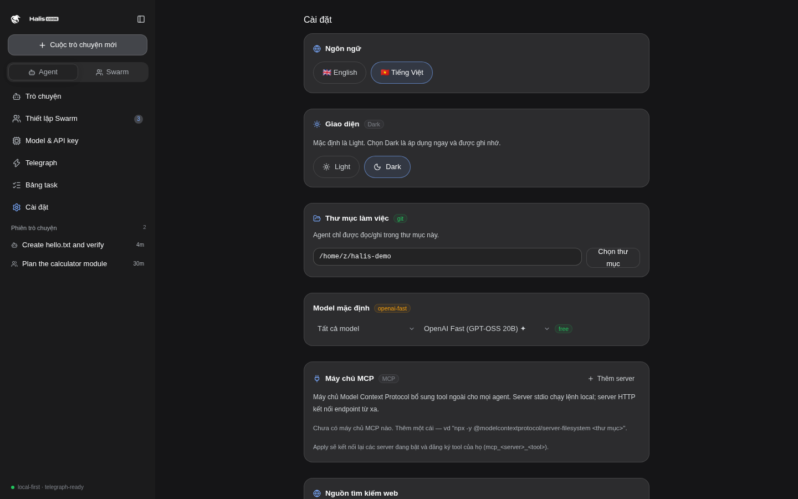

# Demo & submission guide — Halis Code

Everything a reviewer needs to open the app cold, produce settled transactions, and count them.

## 1. Run it cold

```bash
npm install
npm run dev        # dev build with HMR
# or the packaged app:
npm run dist       # electron-builder output for your platform
```

No API key is needed for the first run: the default model is the keyless Pollinations gateway (`openai-fast`). Telegraph discovery (miners, intents, signals) is free and works before any wallet exists.

The app boots in the **Light** theme. Prefer dark? Settings → **Appearance** → Dark applies instantly and is remembered.



## 2. Wire the wallet (60 seconds)

1. Telegraph tab → **Create wallet** (or **Import key** for an existing burner).
2. Fund it with testnet USDC on Base Sepolia — faucets: Alchemy, Coinbase. A little ETH is welcome but not required: x402 settlement is an EIP-3009 authorization, the facilitator submits the transaction and pays gas.
3. The status card shows address, live USDC balance, miners online, intents, and spend to date.

## 3. Produce settled transactions

- **From the Telegraph tab:** type a question into *Try a paid ask* → **Buy answer**. Cost ~$0.01. The result card shows miner, intent, cost, and the tx hash link.
- **From the agent:** ask Halis anything that deserves a verified answer — *"buy a security review of this function from Telegraph"*, *"don't guess: purchase a code review of src/auth.ts"*. An approval card quotes the exact price from the 402 challenge before anything moves.
- **Autonomous leg (machines transact):** in Swarm Setup give an agent `USDC auto-approve up to $0.02` (or click **Always allow** on the first card), then let the swarm work — the agent buys from the network with no human on that leg.

## 4. Count the volume

Telegraph tab → receipts table lists every settled request (time, intent, miner, amount, tx hash — each click-through to the explorer):

- **Copy tx hashes** — one click puts every unique settlement transaction on the clipboard.
- **Export receipts** — downloads `halis-telegraph-receipts-<date>.json` with the full ledger (receipt hash, payer, miner, intent, amount, tx hash, epoch, chain, signal hash).

Ledger keys on `receipt_hash` (per call) — facilitators may batch settlements, so several receipts can share one tx.

## 5. Verify an answer after the fact

Every paid ask's verifiable record is a signal. `telegraph_signals` (agent tool) lists recent signals and re-checks any hash against the node for free. In the Telegraph tab, paste a signal hash into the verify flow to fetch the recorded answer.

## 6. The boundary line (always on screen, unprompted)

The cyan banner on the Telegraph tab states it verbatim:

> Testnet: routing, ranking, verification and settlement are real; only the denomination stands in until mainnet.

Mainnet readiness: chain ID, USDC address, explorer, node URL and price source all live in `TELEGRAPH_NETWORKS` (`src/shared/types.ts`). Switching to mainnet is `Settings → Network → Base (mainnet)` — a config change, not a code change.

## 7. 60-second video shot list

1. (0–8s) Cold open on the chat: ask Halis to build a small app — streaming answer, tool cards.
2. (8–20s) The agent hits something it shouldn't guess → approval card *"Buy intelligence for $0.01"* → approve → answer streams in with a receipt chip.
3. (20–32s) Telegraph tab: wallet, live USDC balance, spend panel; click a tx hash through to the explorer.
4. (32–44s) Swarm Setup → save Planner + Coder + Reviewer → swarm turn where the coder buys a review autonomously (no human click).
5. (44–60s) Copy tx hashes / export receipts; boundary banner on screen; closing line: *"A coding agent that buys the answer instead of hallucinating it."*

## 8. Troubleshooting

| Symptom | Cause / fix |
|---|---|
| Ask fails with insufficient funds | Fund the wallet with testnet USDC (faucet); check the balance card. |
| Ask fails 402 with an empty wallet | Same as above — the 402 challenge is the price quote; paying needs USDC. |
| Node unreachable badge | `devnode.telegraphprotocol.com` briefly down — retry; discovery is free. |
| Model picker empty of paid models | Keys live in Models & Keys — paste a provider key, or stay on the keyless tier. |
| Telegraph tab missing | Settings → Telegraph Protocol switch is off; flip it back on. |
